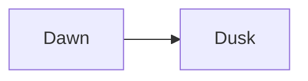

Jot's notes are plain Markdown files. This is what Jot reads in them, and what each shows as.

## Text

```text
# Heading 1, ## Heading 2, ### Heading 3
**bold**, *italic*, ~~struck through~~, `code`
> A quote
---
```

The line `---` on its own draws a rule. Ctrl+B, Ctrl+I, Ctrl+Shift+X and Ctrl+E format the
selection, and Ctrl+1 to Ctrl+3 make headings.

## Lists

```text
- A bullet
  - Nested under it, with Tab
1. A numbered item
- [ ] A to-do
- [x] A done to-do
```

Return carries a list on, and Return on an empty item ends it.

## Links and embeds

```text
[Another note](Another%20note.md)
[A heading in it](Another%20note.md#a-heading)
[From the top of the vault](/Notebook/Another%20note.md)


[A website](https://example.org)
```

Links are plain Markdown, so other editors follow them too. A link to a note that does not exist
yet makes it when followed. An embed shows a picture, or plays a sound or a video, in place.
Typing `](` after a link's words, or pressing Ctrl+K, offers the notes to link to.

## Tags

```text
#ferry and #cast/lead
```

A tag is a `#` and a word, and `/` nests one tag in another. Tags show in the sidebar, and sort
notes and to-dos alike. Front matter can give them too, as `tags: [ferry]`.

## To-dos

A to-do says when it is due, how it repeats, its priority and when it was done in plain words
after it, each starting with `@`:

```text
- [ ] Call Soren #calls @due 2026-11-02 14:00 @p1
- [ ] Water the plants @weekly @due 2026-11-02
- [ ] Review the budget @every 2 weeks on monday @due 2026-11-02
- [x] Pay rent @monthly @due 2026-11-01 @done 2026-11-01
```

- `@due` and a date is when it is due, with a time after it if it has one. Other ways of saying
  a day, as `@due tomorrow 3pm`, `@due friday`, `@due nov 14` or `@due 11-14-2026` (month first),
  are written as its date once you leave the line.
- `@daily`, `@weekly`, `@monthly`, `@yearly` and `@weekdays` repeat it. `@every` takes any
  other rule: `every 3 days`, `every other week`, `every monday`, `every 2 weeks on friday`.
  Ticking one that repeats writes the next one above it.
- `@p1` is urgent, `@p2` high, `@p3` medium and `@p4` low. One without is of no priority.
- `@done` and a date is when it was done. Jot writes it when you tick a to-do, and `@done
yesterday`, a weekday, or `@done` alone (today) are written as their dates, the to-do ticked,
  once you leave the line.

Typing `@` on a to-do offers all of these. Quick add, Ctrl+Shift+A, takes a to-do as you would
say it, such as `call Soren tomorrow 3pm p1 #calls`, and Ctrl+Shift+D sets the day of the to-do
the cursor is on.

## Front matter

Front matter is YAML between `---` lines at the very top of a note:

```yaml
---
tags: [ferry, cast/lead]
aliases: [Mara]
target: 2000
lang: en_GB
---
```

- `aliases` are other names links can use to find the note.
- `target` is the words the note is meant to reach, shown under it as you write.
- `lang` is the language its spelling is checked in.

Typing a key at the start of a line offers the keys Jot reads and those other notes use, and
after a key, its values: the vault's tags and types, dictionaries for `lang`, `on` and `off`,
and today for `created`.

- `tasks: off` keeps its checkboxes out of Tasks, for a checklist that holds no to-dos. They still
  tick.

## Tables

```text
| Crossing | Fare |
| -------- | ---- |
| Dawn     | 2    |
```

Tab moves to the next cell, and the table button lines a table up.

## Code, math and diagrams

````text
```python
print("A fenced block is colored by its language")
```

$E = mc^2$ inline, and on lines of its own:

$$
\int_0^1 x\,dx
$$


````

Math is drawn from LaTeX, and a Mermaid block is drawn as its diagram.

## Comments and suggested edits

CriticMarkup marks suggested changes, and notes to yourself:

```text
{++added++} {--deleted--} {~~this~>that~~} {==highlighted==} {>>a comment<<}
```

Comments show in the margin when the window has room for them.

## The rest

- `:fox` and the start of an emoji's name offers emoji to put in.
- `${toc}` on a line of its own lists the note's headings there.
- `[^1]` marks a footnote, written below as `[^1]: The note.`
